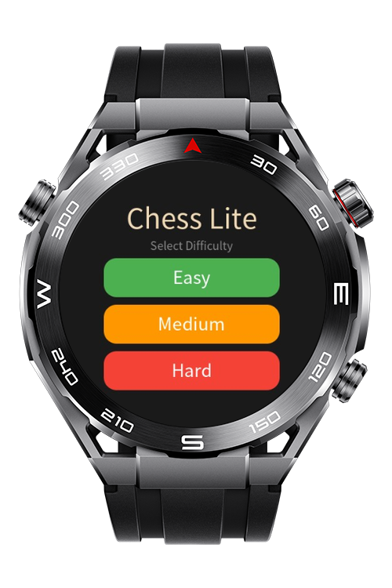
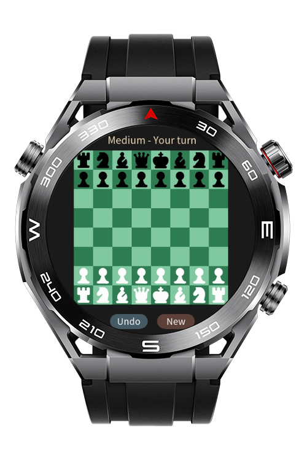
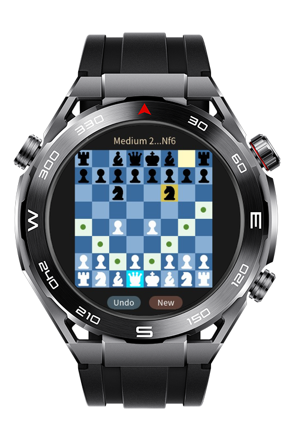
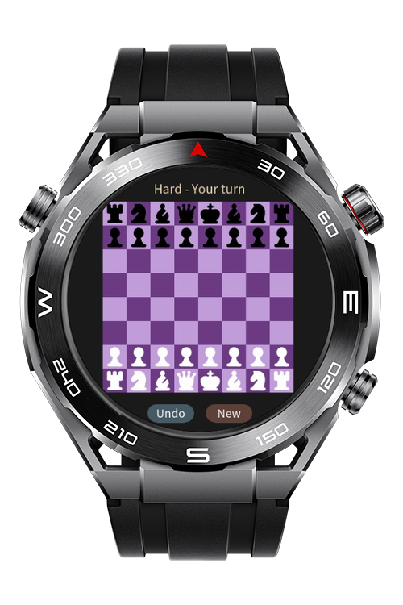

> **Note:** To access all shared projects, get information about environment setup, and view other guides, please visit [Explore-In-HMOS Index](https://github.com/Explore-In-HMOS/hmos-index).

# Chess Lite Wearable

Chess Lite Wearable is a touch-first chess game built for HarmonyOS Lite wearable devices. The project uses a single-page HML/CSS/JS UI, renders an 8x8 board optimized for watch screens, and includes an onboard AI opponent with three difficulty levels.

# Preview

<div>
  
  
  
  
</div>

# Use Cases

**1. Start a Match**

Players begin from the menu overlay and choose `Easy`, `Medium`, or `Hard` difficulty before entering the game.

**2. Touch-Based Move Selection**

Players tap a white piece to select it, view legal moves on the board, and tap a destination square to complete the move.

**3. Play Full Chess Rules**

The game supports standard move validation, castling, en passant, pawn promotion, check, checkmate, stalemate, threefold repetition, the 50-move rule, and insufficient-material draws.

**4. Manage Game Flow**

Players can track captured pieces, undo moves, start a new game, and continue against the built-in black-side AI after each human move.

# Tech Stack

* **Languages:** JavaScript, HML, CSS
* **Platform:** HarmonyOS Lite JS
* **Framework:** HarmonyOS Lite JS page model (`MainAbility`)
* **Build Tools:** DevEco Studio, Hvigor
* **Game Logic:** Local move generator, rule validation, minimax-based AI with alpha-beta pruning

# Directory Structure

```
|-- build-profile.json5
|-- hvigorfile.ts
|-- oh-package.json5
|-- test_ai_flow.js
`-- entry/
    `-- src/main/
        |-- config.json
        |-- js/MainAbility/
        |   |-- app.js
        |   |-- common/assets/chess_media/
        |   |   |-- black_bishop.png
        |   |   |-- black_king.png
        |   |   |-- black_knight.png
        |   |   |-- black_pawn.png
        |   |   |-- black_queen.png
        |   |   |-- black_rook.png
        |   |   |-- white_bishop.png
        |   |   |-- white_king.png
        |   |   |-- white_knight.png
        |   |   |-- white_pawn.png
        |   |   |-- white_queen.png
        |   |   `-- white_rook.png
        |   |-- i18n/
        |   |   |-- en-US.json
        |   |   `-- zh-CN.json
        |   `-- pages/index/
        |       |-- index.css
        |       |-- index.hml
        |       `-- index.js
        `-- resources/base/
            |-- element/string.json
            `-- media/
                |-- icon.png
                `-- icon_small.png
```

# Constraints and Restrictions

## Supported Device

* HarmonyOS Lite wearables (sport watch)

# LICENSE

**Chess Lite Wearable** is distributed under the terms of the MIT License.
See the [LICENSE](/LICENSE) for more information.